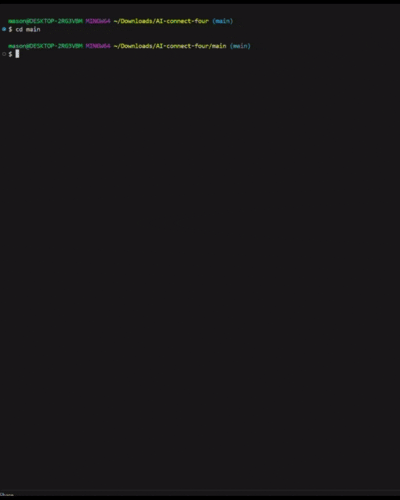

# AI Connect Four

A Python implementation of the classic Connect Four game with an AI opponent.  
Play locally against an AI that evaluates the game board and chooses strong moves, making it a fun way to explore basic game AI concepts.

---

## Description

This project implements:

- A **Connect Four game engine** (board, moves, win/draw detection).
- An **AI opponent** that analyzes the board and selects moves programmatically.
- A **playable interface** so you can challenge the AI and visualize how it responds in real time.

## Play in the browser

The Next.js / TypeScript frontend renders the tabletop in Three.js. The computer runs the original `main/connect_four.py` with Pyodide in a dedicated browser worker. The runtime and fonts are served with the app.

Use Node.js 22.13 or later and run these commands from the project root.

```sh
npm ci
npm run dev
```

Open **http://localhost:3000**. Click or tap a column, press a number from 1 to 7, or use the arrow keys and Enter. You play coral (X) and the computer plays gold (O). Easy, Normal, and Hard search 2, 4, and 5 moves ahead. Normal matches the terminal game's search depth. Your game, score, and settings are saved in this browser. Browsers without WebGL use an interactive pre-render of the same 3D model.

`npm test` checks the turn and scoring rules and exercises the worker with the real Python runtime. `npm run typecheck` checks TypeScript. `npm run build` creates a standalone static site in `out/` that can be served at the root of a web origin.

## Play in the terminal

With Python 3 installed, run this command from the project root:

```sh
python main/script.py
```


### Terminal controls

- You go first in the terminal game. In the browser, the First move setting lets either player open a round.
- Enter the column number (1-7) where you want to drop your piece.
- The AI will automatically make its move after yours.
- The game continues until there is a winner or the board is full (draw).

## Demo



