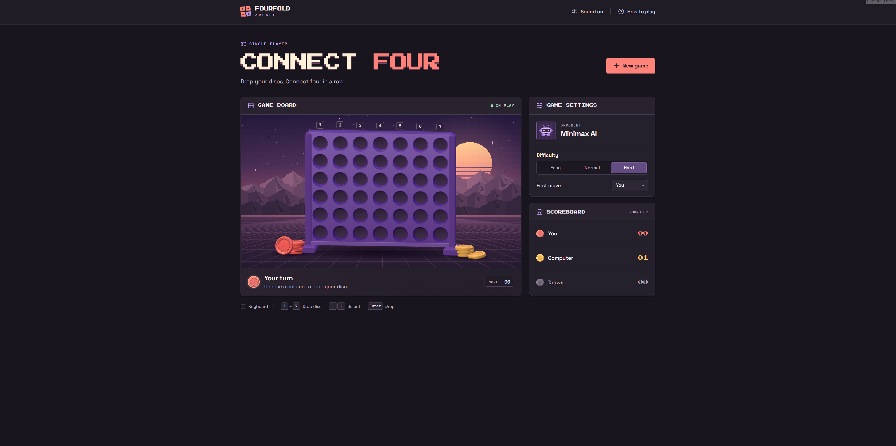
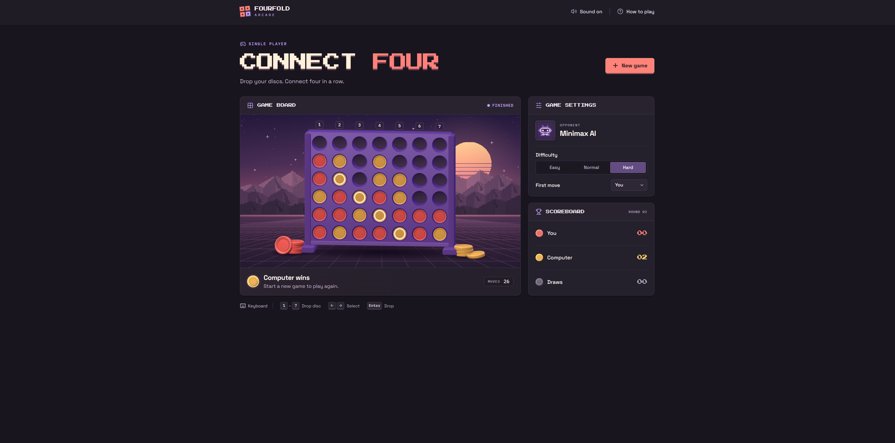

# Fourfold Arcade · AI Connect Four

Play Connect Four against a Python minimax opponent on an animated Three.js board. The browser runs the same Python engine as the original terminal game. A background worker searches for the computer’s next move while the board stays interactive.

[Quick start](#quick-start) · [Screenshots](#screenshots) · [Technology stack](#technology-stack)

## Quick start

Use **Node.js 22.13 or newer** with npm. To clone the project, run the following commands. If you downloaded the ZIP, extract it and open the folder containing `package.json`.

```sh
git clone https://github.com/MasonBoom/AI-connect-four.git
cd AI-connect-four
```

From the project folder, install the locked dependencies and start the development server.

```sh
npm ci
npm run dev
```

Open [localhost:3000](http://localhost:3000). The app serves its own fonts, Python engine, and WebAssembly runtime. A local Python installation is only needed for the optional terminal version or the Python preview command below.

## How to play

You play **coral (X)** and the computer plays **gold (O)**. Each disc falls into the lowest open space in its column. Connect four horizontally, vertically, or diagonally to win. Filling all 42 spaces without a winner ends the round in a draw.

| Action | Control |
| --- | --- |
| Drop a disc | Click or tap a column, or press **1–7**. |
| Aim with the keyboard | Use **←** or **→** to select a column, then press **Enter**. |
| Choose who starts | Set **First move** to **You** or **Computer**. During an active round, the choice applies to the next game. |
| Start another round | Select **New game**. The scoreboard carries over. |
| Toggle move sounds | Select **Sound on** or **Sound off** in the header. |

The browser saves the current round, scores, and settings on the device. Reloading the page resumes play. The board supports reduced motion and switches to an interactive pre-rendered view when WebGL 2 is unavailable.

## Screenshots

**Opening position.** The board is empty, Hard difficulty is selected, and the player has the first move.

[](images/connectfour1.png)

**Computer victory.** On move 26, the four gold discs outlined in white form a descending diagonal from column 2 to column 5.

[](images/connectfour2.png)

## How the AI chooses a move

React sends the board and search depth to a dedicated Web Worker. The worker loads the Python engine through Pyodide and calls `minimax`. The search considers legal replies from both players, scores potential runs of four at its depth limit, and uses alpha–beta pruning to skip branches that cannot improve the result. The worker returns a column. TypeScript applies the move, checks for a win or draw, and updates the board and scoreboard.

| Difficulty | Search depth |
| --- | --- |
| Easy | 2 moves ahead |
| Normal | 4 moves ahead. This is the browser default and the terminal game’s depth. |
| Hard | 5 moves ahead |

Each move in the search is one disc dropped by one player.

## Run the terminal game

The original command-line game uses Python 3 and its standard library. From the project root, run `py -3 main/script.py` on Windows or `python3 main/script.py` on macOS or Linux. You move first as X. Enter a column from 1 to 7 at each prompt. [Watch the terminal demo](images/connect4gif.gif).

## Tests and production build

| Command | What it does |
| --- | --- |
| `npm run typecheck` | Checks the TypeScript source without emitting JavaScript. |
| `npm test` | Tests gravity, turn order, full columns, wins in four directions, draws, and scoring. It also runs the worker adapter with the actual Python engine to check a winning move and a forced block. |
| `npm run prepare:engine` | Copies the bundled Pyodide files and `main/connect_four.py` into `public/engine/`. The development and build commands run this automatically. |
| `npm run build` | Builds the production site and writes the static export to `out/`. |

Deploy the **contents of `out/`** at the root of a static web host. Keep `_next/`, `engine/`, and `ai-worker.js` at their exported paths so the browser can load the app and its opponent. To preview the build with Python 3, run the following command and open [localhost:8080](http://localhost:8080).

```sh
python3 -m http.server 8080 --bind 127.0.0.1 --directory out
```

On Windows, use `py -3` in place of `python3`.

## Technology stack

| Area | Technologies used |
| --- | --- |
| Web application | Next.js 16.4.6 with the App Router and static export, React 19.3.1, React DOM 19.3.1, TypeScript 5.9.3 with TSX, JavaScript ES modules, HTML, and CSS. |
| Board and scenery | Three.js 0.187.0 and WebGL 2 render the board and discs. The Canvas 2D API draws the pixel landscape. `requestAnimationFrame` drives drops and `ResizeObserver` keeps the board aligned with the column controls. |
| Game AI | Python 3, Pyodide 0.27.7, WebAssembly, Web Workers, the Fetch API, and JSON. The Python engine uses the standard-library `copy` and `random` modules. |
| Input, sound, and saved games | Pointer and keyboard events, the Web Audio API, Web Storage (`localStorage`), native HTML dialogs, ARIA live announcements, and the `prefers-reduced-motion` media query. |
| Icons and type | Lucide React 0.468.0 supplies the icons. Fonts are bundled through `@fontsource/space-grotesk`, `@fontsource/press-start-2p`, and `@fontsource/ibm-plex-mono`, all at version 5.3.0. |
| Build and tests | Node.js, npm, Webpack, the Next.js SWC compiler, and the TypeScript compiler (`tsc`). Tests use Node’s built-in `node:test`, `node:assert/strict`, and `node:vm`. |
| Type definitions | `@types/node`, `@types/react`, `@types/react-dom`, and `@types/three`. |
| Artwork | Blender with the Cycles renderer, NumPy, and Pillow were used to prepare the fallback artwork. The project ships WebP board and disc images, a PNG aperture mask and screenshots, an SVG favicon, and a GIF terminal demo. |
| Source and delivery | Git, GitHub, Markdown, and static web hosting. The original private browser build was deployed with ChatGPT Sites. |

The package manifest lists the direct dependencies. The lockfile records the exact versions of the full npm dependency tree. [Package manifest](package.json) · [Dependency lockfile](package-lock.json)

## Project layout

| Path | Purpose |
| --- | --- |
| `app/` | Next.js page, root layout, fonts, and global styles. |
| `components/` | Game controls, scoreboard, accessible column buttons, and the pixel landscape. |
| `lib/game.ts` | Browser-side move validation, win detection, scoring, and saved-game state. |
| `lib/tabletop.ts` and `lib/board-view.ts` | Three.js scene and the column coordinates for the pre-rendered board. |
| `main/connect_four.py` and `main/script.py` | Shared Python game engine and terminal entry point. |
| `public/` and `scripts/prepare-engine.mjs` | Browser worker, board artwork, and the script that stages the Python runtime. |
| `tests/` | Game-rule tests and the Python worker integration test. |
| `images/` | README screenshots and the original terminal demo. |
